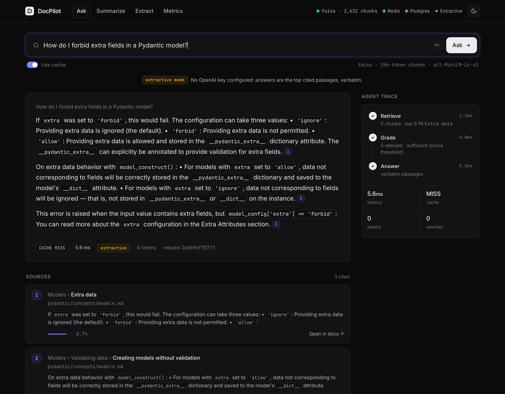

# DocPilot

A production-style RAG + agent backend that answers questions over the **FastAPI and Pydantic documentation**, with every claim cited to a doc section. When the retrieved evidence doesn't support an answer, it replies **"insufficient evidence"** instead of guessing.

Async FastAPI · LangGraph agent · FAISS and Chroma behind one interface · Redis cache with in-memory fallback · PostgreSQL query log · multiprocessing ingestion · OpenAI structured outputs · Docker Compose.



## Measured results

Every number below comes from a script in this repo, and the result files are in [`bench/results/`](bench/results). Corpus: FastAPI `0.162.5` + Pydantic `v2.14.3` docs, 179 pages, 1,528 sections, about 400k tokens.

| What | Result | Script |
|---|---|---|
| Retrieval, 50 labelled questions, 256-token chunks | **recall@5 0.74 · MRR 0.596** | `eval/retrieval_eval.py` |
| Retrieval, 512-token chunks | recall@5 0.76 · MRR 0.620 (a 1-question difference) | `eval/retrieval_eval.py` |
| FAISS vs Chroma, same 2,632 vectors | query p50 **0.064 ms vs 0.864 ms** (13.5×), build 0.02 s vs 1.54 s, disk 6.8 MB vs 31.8 MB, identical recall | `bench/store_bench.py` |
| Profiling fix: length-sorted embedding batches | cold ingest **23.4 s → 18.9 s** (median of 3); padding 1.45× → 1.02× | `bench/profile_ingest.py` |
| Incremental re-ingest (content hashes) | **0.4 s** vs 27.7 s cold; 2,632/2,632 chunks skipped | `python -m docpilot.cli ingest` |
| Process pool for parse + chunk (11 workers) | 0.62× at 1× corpus (spawn overhead), 1.8× at 4×, **3.4× at 16×** | `bench/pool_bench.py` |
| Out-of-corpus questions refused | _pending: needs `OPENAI_API_KEY`_ | `eval/answer_eval.py` |
| `/ask` latency, cache miss vs Redis hit | _pending: needs `OPENAI_API_KEY`_ | `eval/latency_bench.py` |
| Tests | 50 hermetic (about 2 s, no network) + 3 integration (Postgres, Redis) | `pytest`, `pytest -m integration` |

The reasoning behind each choice (chunk size, FAISS vs Chroma, cache keys, LangGraph, multiprocessing vs asyncio) is in **[INTERVIEW.md](INTERVIEW.md)**.

## Architecture

```mermaid
flowchart LR
    subgraph Ingest["Ingestion · python -m docpilot.cli ingest · POST /ingest"]
        A[FastAPI + Pydantic docs<br/>pinned git tags] --> B[Parse Markdown → sections<br/>by heading path]
        B --> C[Section-aware chunks<br/>256 tok, 32 overlap]
        C --> D{content hash<br/>already indexed?}
        D -- new --> E[Async batched embeddings<br/>length-sorted · local or OpenAI]
        D -- unchanged --> X[skip]
    end
    B -. multiprocessing.Pool .- C
    E --> F[(VectorStore<br/>FAISS or Chroma)]
    C --> P[(PostgreSQL<br/>documents · chunks · query_log)]

    U[Web UI / client] -->|"/ask/stream (SSE)"| API[Async FastAPI]
    API --> R{Redis<br/>↳ in-memory LRU fallback}
    R -- hit --> U
    R -- miss --> G
    subgraph G["LangGraph agent"]
        G1[retrieve] --> G2[grade · JSON schema]
        G2 -- sufficient --> G3[answer + citations]
        G2 -- weak, 1st time --> G4[rewrite query] --> G1
        G2 -- still weak --> G5[refuse]
        G3 -- citation not graded relevant --> G5
    end
    G1 --> F
    API -->|latency, cache_hit, tokens, top-k ids| P
```

## Endpoints

| Method | Path | What it does |
|---|---|---|
| `POST` | `/ask` | Cited answer from the agent, or a refusal. `x-cache: HIT/MISS` header |
| `POST` | `/ask/stream` | Same, as Server-Sent Events: one `step` event per graph node, then `result` |
| `POST` | `/summarize` | Summary + key points for a doc or one section (map-reduce for long pages) |
| `POST` | `/extract` | Typed fields via OpenAI strict JSON schema: `endpoint`, `config_options`, `error` |
| `GET` | `/extract/schemas` | The available extraction schemas |
| `POST` | `/ingest` | Background ingest job (incremental); returns `job_id` |
| `GET` | `/ingest/{id}` | Job progress and result counts |
| `GET` | `/metrics` | From SQL: queries, p50/p95 split by cache hit/miss, refusal rate, tokens, recent queries |
| `GET` | `/documents` | Indexed pages and their sections |
| `GET` | `/bench` | Measured benchmark results |
| `GET` | `/healthz` | Index, Redis, Postgres and LLM status |

```bash
curl -s localhost:8000/ask -H 'content-type: application/json' \
  -d '{"question":"How do I forbid extra fields in a Pydantic model?"}' | jq '.answer, .citations[].heading_path'
```

## Run it

**Docker (everything):**
```bash
cp .env.example .env          # add OPENAI_API_KEY (optional: without it, answers are extractive)
docker compose up --build     # api + postgres + redis; first boot fetches the docs and builds the index
open http://localhost:8000
```

**Local dev:**
```bash
python3.12 -m venv .venv && . .venv/bin/activate
pip install -r requirements.txt
sh scripts/macos_dev_setup.sh          # macOS only: faiss + torch share one OpenMP runtime
docker compose up -d postgres redis
python -m docpilot.cli fetch && python -m docpilot.cli ingest
uvicorn docpilot.api.main:app --reload
```

**Evaluate and benchmark:**
```bash
python -m docpilot.cli ingest-all          # FAISS + Chroma × 256 + 512
python -m eval.retrieval_eval              # recall@5, MRR
python -m eval.answer_eval                 # refusal rate, citation accuracy (server running, key set)
python -m eval.latency_bench               # /ask p50/p95, cache miss vs hit
python -m bench.store_bench && python -m bench.pool_bench
python -m bench.profile_ingest --label before   # cProfile + median of 3
```

**Tests:**
```bash
pytest -q                     # hermetic: no key, no network
pytest -m integration         # needs docker compose postgres + redis
```

## Layout

```
docpilot/
  ingest/   fetch (pinned corpus) · parse (Markdown → sections) · chunk · pipeline (process pool, hashes)
  embed/    async batched embedder · local sentence-transformers · OpenAI
  store/    VectorStore interface · FAISS · Chroma
  agent/    LangGraph graph · prompts + JSON schemas · llm.py (the single OpenAI seam)
  cache/    Redis + fallback · in-memory TTL/LRU · cache keys
  db/       schema.sql (hand-written) · repo.py (asyncpg, raw SQL)
  api/      FastAPI app · request-id JSON logging
  service.py   ask / summarize / extract
web/        single-file UI (no framework, no build step)
eval/       labelled questions · out-of-corpus set · retrieval / answer / latency evals
bench/      store, pool and profiling benchmarks · results/*.json
tests/      50 hermetic + 3 integration
```

## Notes

- **Corpus licence:** FastAPI and Pydantic docs are MIT. They are fetched at a pinned tag (`data/SOURCES.md` records the commit SHAs) and not committed.
- **Eval labels** were written by an AI assistant, and each is backed by a verbatim evidence quote that `eval/remap_labels.py` checks against the gold section. See [`eval/LABELLING.md`](eval/LABELLING.md) for the method and limits.
- **Offline mode:** with no `OPENAI_API_KEY`, the grader falls back to a similarity threshold and answers are the top cited passages verbatim. Summarize and extract need the key.

MIT licence.
